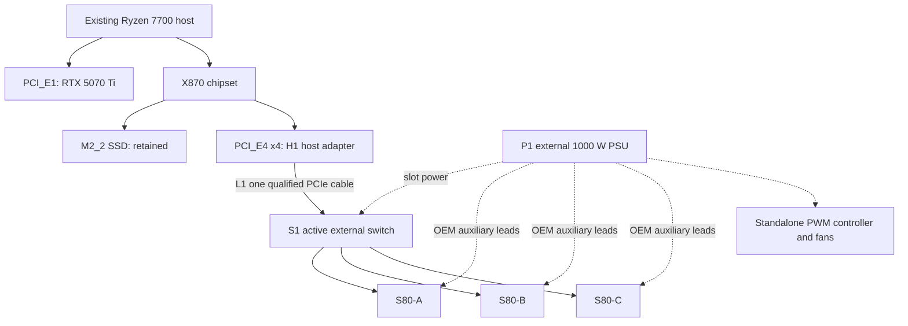

# QOVARYX — Three-S80 External GPU Shelf
## Engineering specification, purchasing dossier, and 3D-printing handoff

**Owner:** Thomas Jarvis  
**Document ID:** QOVARYX-HW-S80-SHELF  
**Revision:** 0.9 — 2026-09-05  
**Status:** DESIGN / QUALIFICATION PACKAGE — NOT A VERIFIED PLUG-AND-PLAY BUILD  
**Units:** millimetres, watts DC unless explicitly AC, decimal GB/s for link bandwidth  
**Proposed population:** 3 × Moore Threads MTT S80; existing RTX 5070 Ti stays internal  
**Rack PSU target:** one quality 1000 W ATX supply; existing PC PSU is unchanged

> **Read this before spending money.** The desired architecture is electrically plausible, but its end-to-end compatibility is not established. The largest unresolved issue is S80 compute support on the owner's Ryzen/Windows/WSL machine, not the printed harness. The currently published S80 community MUSA packages name Intel + Ubuntu, and a real, documented Gen4 switched backplane is considerably more expensive than previously estimated. This package records those limitations rather than converting earlier assumptions into purchase instructions.
>
> No hardware has been tested on the owner's machine for this document. No S80 training throughput, three-card enumeration, GPU peer-to-peer support, final mounting-hole pattern, or thermal qualification is claimed. The included CAD is editable reference/prototype geometry, not a certified enclosure or a final PCB drilling template.

---

## Contents

1. Design decision and release gates
2. Owner requirements and existing system
3. Verified facts and corrections
4. Frozen electrical architecture
5. Purchasing bill of materials and costs
6. Cable and connector schedule
7. Power architecture and operating sequence
8. Mechanical blueprint and coordinate system
9. Printed parts, fabrication, and CAD release
10. Thermal, airflow, and electrical housekeeping
11. Assembly and first-power procedure
12. BIOS, operating system, and driver compatibility
13. Local Intelligence integration
14. Benchmark and acceptance plan
15. Failure recovery and troubleshooting
16. Supplier questions ready to send
17. Instructions for the next AI or engineer
18. Evidence, measurements, and revision control
19. Sources and purchasing references

---

## 1. Design decision and release gates

### 1.1 The architecture is fixed; its implementation still needs qualification

Build a **single-host, externally powered, three-GPU shelf**. Take data from the motherboard's lower PCI_E4 slot, carry it to an active PCIe switch in the shelf, and attach all three S80s downstream of that switch. Use one external 1000 W PSU for all rack electronics and all three cards. Keep both existing NVMe drives and the RTX exactly where they are.

**Do not substitute** a second computer, mining x1 splitters, three separate M.2 links, a passive Y-ribbon, or CPU-slot bifurcation without explicit owner approval. Those are different architectures, not hidden implementation details.

This document uses an **integrated c-payne PM40084 switch backplane as the reference implementation** because its manufacturer explicitly documents multiple GPU slots, remote PCIe input, local power, and a CAD model. It has four slots; only three are populated. It is not a recommendation to buy a fourth S80. The board's price is a substantial drawback. A less expensive HighPoint-based modular alternative is described separately, but it is not electrically or mechanically interchangeable without new verification. [S08–S13]

### 1.2 Gates that must be closed

| Gate | Evidence required to close it | Current state | Buying consequence |
|---|---|---|---|
| G0 — Host compute support | Working, reproducible S80 driver/runtime path on Ryzen 7700; exact OS and versions; explicit Windows/WSL requirement resolved | OPEN | Do not order three S80s |
| G1 — Single-card qualification | One card runs the intended inference and training smoke tests on this host without destabilizing RTX/NVMe | NOT RUN | Only one returnable experimental card after G0 risk is accepted |
| G2 — Switched link | Vendor confirms x4 upstream operation, exact port/cable mapping, firmware, large BAR allocation and GPU support | OPEN | Do not buy an unreturnable switch |
| G3 — Power harness | Exact S80 auxiliary connector and OEM adapter confirmed; every PSU cable/output and backplane input assigned safely | OPEN | Wattage alone does not release the PSU purchase |
| G4 — Mechanical release | Actual PCB CAD/hole pattern, connector keepouts, card support locations, PSU dimensions verified | OPEN | No final PCB drilling, no full production print batch |
| G5 — Three-card acceptance | Repeated cold boots, independent workloads, errors/temperatures/power measured; application integration tested | NOT RUN | No unattended production operation |

**Decision boundary:** preserving concurrent Windows/WSL operation is a requirement unless the owner explicitly changes it. If no usable S80 compute driver path exists for that requirement, stop this S80 implementation. Reuse the architecture and mechanical work only after the owner chooses a supported accelerator. Do not disguise a dual-boot Linux conversion as a transparent hardware upgrade.

### 1.3 What this package does provide

It specifies the complete proposed topology, real component candidates and links, quantities, price provenance, power/control relationships, a dimensioned modular frame concept, fit-check CAD, measurements required for final mounts, assembly order, local service integration, qualification tests, rollback, and supplier questions. Any unavailable information is deliberately marked **TBD**, **RFQ**, or **NOT TESTED**, never invented.

---

## 2. Owner requirements and existing system

### 2.1 Requirements taken from the conversation

| ID | Requirement |
|---|---|
| R01 | One existing host; no separate motherboard/CPU/server build |
| R02 | Three external S80s, acquired one first and two later only after successful tests |
| R03 | One host PCIe connection for the shelf, using an active switch |
| R04 | Existing RTX 5070 Ti remains in PCI_E1 |
| R05 | Existing M2_1 and M2_2 SSDs remain installed; M2_3 remains empty |
| R06 | External PSU target is 1000 W, not an automatic increase to 1300 W |
| R07 | Printer is an Ender-3 S1 Pro; parts must fit its build volume |
| R08 | GPU bodies may overhang the rear; no need for a full-length enclosure |
| R09 | Independent inference workers and small-model experiments are primary targets; large-model/multi-GPU training is experimental |
| R10 | Inference stays local; preserve the existing Local Intelligence/Factory workflow and stop controls |

### 2.2 Existing host — owner reported, not live-inspected

| Item | Recorded configuration |
|---|---|
| CPU | AMD Ryzen 7 7700 |
| Board | MSI PRO X870-P WIFI |
| Memory | 64 GB DDR5 |
| Existing GPU | NVIDIA RTX 5070 Ti, 16 GB |
| Existing PSU | 750 W; make/model and cable map not inspected |
| Software | Windows + WSL2; existing LI project record identifies Ubuntu 24.04 |
| Storage | CPU-connected NVMe in M2_1; Gen4 NVMe in M2_2; other storage exists but is not affected by this design |
| Printer | Creality Ender-3 S1 Pro; nominal build volume 220 × 220 × 270 |

The uploaded `LI_CONTEXT_SPEED_AND_DOCKER_CODEX_PROMPT.md` identifies the application as `E:\python_gpu\local_ai_farm`, exposed as `/mnt/e/python_gpu/local_ai_farm` in WSL, distinct from the Factory control workspace. It records an owner-selected Qwen 3.8 27B Q2_K route, `farm/current:qwen38-q2-16k`, with context 16384. These are application records, not independent verification of a public model release or a new benchmark. Preserve the working default. [U01]

### 2.3 Motherboard attachment map

For the recorded Ryzen 7000 processor, MSI publishes the following layout. [S01]

| Connector | Electrical link | Used by this blueprint |
|---|---|---|
| PCI_E1, full-length | CPU PCIe 5.0 x16 | Existing RTX; unchanged |
| PCI_E2, full-length | Chipset PCIe 3.0 x1 | Unused |
| PCI_E3, full-length | Chipset PCIe 3.0 x1 | Unused |
| PCI_E4, full-length | Chipset PCIe 4.0 x4 | Shelf host adapter |
| M2_1 | CPU PCIe 5.0 x4 | Existing SSD |
| M2_2 | Chipset PCIe 4.0 x4 | Existing SSD |
| M2_3 | Chipset PCIe 4.0 x2 | **Must remain empty** |

Populating M2_3 reduces PCI_E4 to x2. There is no M2_4 on this board. M2_2 does not consume PCI_E4's particular lane allocation, but chipset-attached devices still contend for upstream resources. “No direct lane sharing” does not mean unlimited independent bandwidth to the CPU.

---

## 3. Verified facts and corrections

### 3.1 The S80 is a supported *backend target*, not a verified complete system

The manufacturer lists the S80 as 16 GB GDDR6, 448 GB/s local memory bandwidth, 14.7 TFLOPS FP32, PCIe 5.0 x16, up to 255 W TGP, and 285 × 112 × 49 mm. Those specifications do not establish training speed on the owner's software. [S02]

Upstream llama.cpp documents MUSA and architecture `21` for S80. Moore Threads' `torch_musa` supports a PyTorch backend, but its documentation says MCCL is not provided for S80/S3000. The vendor's S80 community SDK packages list Intel + Ubuntu. These are separate facts, and none proves Ryzen + Windows + WSL + an external switch works. [S03–S05]

### 3.2 Corrections to earlier advice

| Earlier idea | Correct engineering interpretation |
|---|---|
| Three S80s are automatically a good training bargain | Actual training throughput and required operators are unmeasured; value is not established |
| Ordinary LoRA/QLoRA recipes should just run | Must validate the exact PEFT/quantization/optimizer kernels; CUDA-only dependencies cannot be assumed portable |
| Docker separates away all driver trouble | Containers still require a working host GPU driver and supported device access |
| Ryzen/Windows will see the cards, so AI should work | PCIe enumeration, display output, and compute-runtime support are different acceptance stages |
| A reliable Gen4 switch will be $200–350 | That was not verified; documented candidates found here are materially more expensive |
| Three S80s plus RTX provide 64 GB pooled training memory | They provide four separate 16 GB memory pools; pooling requires explicit supported software |
| One ribbon can be split passively | This design requires an active switch; a host adapter/redriver is not a switch |
| Low TFLOPS means PCIe cannot be a bottleneck | Traffic depends on residency, offload, communication and batching, not just peak arithmetic |
| Add 75 W slot power on top of each 255 W TGP | TGP is the total GPU board budget; slot power is part of it, not an extra 75 W |
| Any 8-pin power plug is equivalent | EPS, PCIe, GPU-specific adapters and PSU-side modular plugs must be identified exactly |

### 3.3 Workload expectations

The useful first target is **three independently scheduled resident models**, or independently qualified small-model training experiments. A single process spanning CUDA and MUSA, or synchronized training across all three S80s, is outside the guaranteed scope. Even three-S80 layer-split inference is a later test, not a purchasing assumption.

Do not publish a claimed S80 tokens/second rate or a percent of 5070 Ti training performance from its FP32 specification. Benchmark the same model, sequence length, precision, optimizer, batch and correctness requirements. Inference generation rate is not training rate.

---

## 4. Frozen electrical architecture

### 4.1 Functional schematic — integrated-backplane reference

```text
                         EXISTING MAIN PC
       +--------------------------------------------------+
       | Ryzen 7 7700 / MSI PRO X870-P WIFI               |
       |                                                  |
       | PCI_E1 ------------ RTX 5070 Ti                 |
       | M2_1 -------------- existing NVMe                |
       | M2_2 -------------- existing Gen4 NVMe           |
       | M2_3 -------------- EMPTY                        |
       |                                                  |
       | PCI_E4, Gen4 x4                                  |
       |        |                                         |
       |        +-- H1: matched PCIe-to-SlimSAS host board |
       +--------------------------|-----------------------+
                                  |
                     L1: ONE approved PCIe cable
                     first four host lanes only
                     plus required clock/reset/grounds
                                  |
       +--------------------------|-----------------------+
       |                   EXTERNAL SHELF                 |
       | S1: active switched, externally powered backplane|
       |          |               |               |       |
       |       SLOT-A          SLOT-B          SLOT-C     |
       |          |               |               |       |
       |       S80-A           S80-B           S80-C       |
       |                                                  |
       | SLOT-D remains EMPTY; no fourth GPU authorized    |
       |                                                  |
       | P1: one 1000 W PSU                                |
       |   -> backplane/slot power                         |
       |   -> all three OEM GPU auxiliary-power harnesses |
       |   -> start controller and rack fans              |
       +--------------------------------------------------+
```

This is a functional system schematic, **not a pin-level instruction to fabricate a PCIe cable or mains circuit**. Commercial components provide the high-speed routing, slot power conversion, protection, and connectors.

### 4.2 Why the reference uses SlimSAS instead of an unspecified long ribbon

The candidate backplane exposes SlimSAS 8i inputs. Therefore the reference BOM uses the same vendor's PCIe-wired SlimSAS host adapter and cable. OCuLink, MCIO and SlimSAS are not automatically interchangeable because they carry PCIe; connector wiring, lane order, sideband signals and clock arrangement must match.

The selected cable carries up to eight lanes, but the motherboard slot supplies only four. **The vendor must confirm correct x4 link training using the first-lane input/port and exact firmware.** An x8-shaped cable does not manufacture eight host lanes. The unused host adapter connector stays unused. No host bifurcation is requested for this path.

The long cable should be a manufacturer-qualified assembly, initially 45 or 75 cm as geometry permits. A redriver is an analog signal conditioner, not a guarantee of any cable length. No extra couplers, arbitrary extension leads, or field-crimped PCIe cables are allowed in revision 0.9.

### 4.3 Throughput budget

A Gen4 x4 link's coding-limited ceiling is:

```text
16 GT/s × 4 lanes × (128/130) / 8 = 7.877 GB/s per direction
```

Actual application throughput is lower after transaction overhead, chipset contention, implementation and software costs. All cards share this upstream capacity. They are not each guaranteed one-third continuously; a switch arbitrates concurrent traffic.

For example, transferring three 12 GB models means at least 36 GB crosses an appropriate host/storage path. Even an idealized 7.877 GB/s transfer requires about 4.57 seconds; real cold starts take longer. Once weights are resident, independent inference may need little host traffic. Offload, frequent reloads, gradient synchronization and some prefill/activation paths can change this substantially.

Peer-to-peer transfers might stay downstream of the switch, but that requires support from the GPU, runtime, switch configuration, firmware and IOMMU topology. **Do not count on P2P**, and do not disable isolation/security features blindly to try to obtain it.

### 4.4 Mermaid source



---

## 5. Purchasing bill of materials and costs

### 5.1 Price rules

All online observations are snapshots checked for this dossier on **2026-09-05** unless labelled historical. Prices do not establish stock, seller reliability, landed import cost or compatibility. **USD and EUR are intentionally not silently converted.** Taxes, shipping, exchange fees, import charges, returns and tools are additional unless explicitly included.

- **OBSERVED:** advertised on the linked page; recheck checkout.
- **HISTORICAL:** the owner's earlier screenshot, not current verified checkout.
- **ALLOWANCE:** engineering budget, not a retailer quote.
- **RFQ:** request quotation/confirmation; price unknown.
- **HOLD:** do not buy until the stated compatibility gate is closed.

### 5.2 Reference electronics — one integrated active backplane

| ID | Part and required selection | Qty final | Price basis | Extended cost | Purchase state |
|---|---|---:|---|---:|---|
| G1–G3 | [Moore Threads MTT S80 16 GB — owner's AliExpress listing](https://www.aliexpress.us/item/3256812094002197.html) | 3 | HISTORICAL $303.28 + $26.36 shipping/card | $988.92 | One experimental card first; seller, included harness and return terms unverified |
| S1 | [c-payne PCIe Gen4 Switch 4×x16, Microchip PM40084](https://c-payne.com/products/pcie-gen4-switch-4x-x16-microchip-switchtec-pm40084) | 1 | OBSERVED €1,250 | €1,250 | HOLD: x4 upstream/firmware, stock and total slot-power approval |
| H1 | [c-payne SlimSAS Gen4 x16 host adapter, redriver](https://c-payne.com/products/slimsas-pcie-gen4-host-adapter-x16-redriver) | 1 | OBSERVED €80 | €80 | HOLD: operation in an electrically x4 slot, first-port mapping |
| L1 | [c-payne PCIe Gen4 SlimSAS SFF-8654 8i cable](https://c-payne.com/products/slimsas-sff-8654-8i-cable-pcie-gen4) | 1 | OBSERVED €30; 45/75 cm options | €30 | Select length after routing measurement and supplier approval |
| P1 | [EVGA SuperNOVA 1000 GT, 220-GT-1000-X1 — retailer](https://amt1st.com/products/220-gt-1000-x1-evga-1000w-bt-super-nova-power-supply-843368043346) | 1 | OBSERVED $189.99 | $189.99 | HOLD: cable schedule approval; exact model, not 1300 GT/G+/G6 |
| P2 | [AMFELTEC standalone ATX PSU controller, SKU-010-03](https://www.amfeltec.com/atx-psu-controller/) | 1 | RFQ | Unknown | Required function; request price, mounting drawing and operating instructions |
| P3 | Genuine S80 manufacturer auxiliary-power harness | 3 | Seller must include or quote | Unknown if omitted | No generic substitute without verified pinout/current rating |
| F1–F3 | [ARCTIC P14 PWM PST CO, ACFAN00126A](https://www.arctic.de/en/P14-PWM-PST-CO/ACFAN00126A) | 3 | ALLOWANCE $12–18 each | $36–54 | 140 × 140 × 27 mm; use identical revision |
| F4 | [Noctua NA-FC1 standalone PWM controller](https://www.noctua.at/en/products/na-fc1) | 1 | ALLOWANCE $25–40 | $25–40 | Verify supplied PSU adaptor/splitter before buying separate leads |
| F5 | [140 mm metal fan guards — supplier catalogue](https://www.mcmaster.com/products/fan-guards/) | 3 | ALLOWANCE | $9–18 | Required on accessible fan faces |

**Core electronics subtotal, excluding RFQ items and cooling:** **$1,178.91 + €1,360**. This is not an exchange-rate-converted total. The €1,360 is the switch, host adapter and cable alone.

The reference board has 101.6 mm slot pitch and two mandatory power inputs among its four listed EPS-style power connectors. Its product page warns that motherboard firmware can affect enumeration. Obtain the exact revision's manual and CAD; neither AM5 general experience nor the connector's appearance establishes support for this particular x4-cabled S80 configuration. [S08]

**Do not order three separate OCuLink docks for this integrated-backplane option.** Its GPU slots already provide the physical interfaces. Separate receivers belong only to the optional modular alternative below.

### 5.3 Mechanical and safety materials

These are procurement specifications, not a claim that every generic catalogue contains the exact item in stock. Final frame lengths are released only after the backplane drawing is checked.

| ID | Part / purchasing link | Quantity / selection | Cost basis |
|---|---|---|---:|
| M1 | [2020 aluminum extrusion — ZYLtech catalogue](https://www.zyltech.com/store/aluminum-extrusion-hardware/2020-t-slot/) | Cut list in §8; about 4.72 m finished stock | ALLOWANCE $65–100 |
| M2 | [Extrusion custom cutting service](https://www.zyltech.com/aluminum-extrusion-custom-cut-service/) | Quote cuts; account for kerf/waste | Additional if not included in M1 allowance |
| M3 | [2020 metal corner/brace options](https://www.zyltech.com/3-way-corner-angle-bracket-for-2020-or-3030-aluminum-extrusion/) | At least 24 compatible 90° braces with matched screws/T-nuts, plus deck supports | ALLOWANCE $30–45 including hardware |
| M4 | [Aluminum angle stock](https://www.mcmaster.com/products/angles/) | 2 × 420 mm, nominal 20×20×2 mm, deburred; support/retainer rails | ALLOWANCE $12–20 |
| M5 | [Unfilled PETG, 1.75 mm — Polymaker](https://shop.polymaker.com/products/petg) | 1 kg prototype roll; second only if slicer estimate requires it | ALLOWANCE $20–30 |
| M6 | [Adafruit M3×4 heat-set inserts, product 4255](https://www.adafruit.com/product/4255) | 1 × 50-pack; noncritical attachments only | OBSERVED $5.95 |
| M7 | [Metric machine-screw catalogue](https://www.mcmaster.com/products/machine-screws/) | M3/M4/M5 screws, locknuts and washers per §8; no PSU thread substitution | ALLOWANCE $15–25 beyond included extrusion hardware |
| M8 | [Silicone rubber sheet](https://www.mcmaster.com/products/silicone-rubber/) | Nonconductive pads, approximately 2 mm thick, for structural shroud contact only | ALLOWANCE $5–10 |
| M9 | [Rubber feet / bumpers](https://www.mcmaster.com/products/silicone-rubber-bumpers/) | 4 mechanically retained feet; no adhesive-only main load path | ALLOWANCE $5–10 |
| M10 | [Cable ties / mounting hardware](https://www.mcmaster.com/products/cable-ties/) | Releasable straps, edge protection, cable labels, strain-relief fittings | ALLOWANCE $8–15 |
| M11 | [Sheet stock / protective panels](https://www.mcmaster.com/products/sheets/) | Nonconductive guard or correctly bonded/perforated metal guard; keep airflow open | ALLOWANCE $10–20 |
| T1 | [P3 Kill A Watt P4400](https://shop.p3international.com/products/kill-a-watt) | 1 if no suitable meter owned; monitor rack separately | OBSERVED $32.99 |
| T2 | Caliper, temperature probes, screwdrivers, hex keys, deburring tools | Use existing tools; acquire missing items | Not included in build subtotal |

Mechanical material allowance M1/M3–M11: **$175.95–280.95**; cutting services and tools remain separate. Cooling F1–F5 allowance is **$70–112**.

### 5.4 Honest budget summary

```text
3 S80s, historical delivered screenshot basis       $  988.92
1000 GT PSU, observed listing                       $  189.99
Cooling, guards and PWM controller allowance        $   70.00–112.00
Mechanical materials allowance                      $  175.95–280.95
Rack power meter, if needed                         $   32.99
                                                   -----------------
USD subtotal                                       $1,457.85–1,604.85

Integrated switch + host adapter + cable            €1,360.00

PLUS: ATX controller quote; any missing OEM power
harnesses; taxes/duties; currency conversion; freight;
cutting services and any missing tools.
```

This is **not** a $1,500 all-in expansion. The earlier estimate omitted the actual cost of a documented switched PCIe implementation. At these infrastructure prices, pause for a value comparison before committing; inexpensive GPU listings alone do not establish a cost-effective system.

### 5.5 Lower-cost switch route to quote — NOT the released reference BOM

[HighPoint Rocket 1528D](https://www.highpoint-tech.com/product-page/rocket-1528d) is advertised at **$699**. HighPoint also discusses accelerator/GPU expansion for its switch products, but the retail description emphasizes eight x4 NVMe channels while an engineering article describes a four-port x8 configuration. Ask for the exact GPU-capable firmware and x4-upstream qualification. [S12–S13]

A possible modular implementation would require:

```text
H1 host adapter -> one cable -> externally powered receiver R0
R0 x16 slot -> Rocket 1528D switch mounted IN THE SHELF
Rocket -> three matched internal cables -> receivers R1/R2/R3
R1/R2/R3 -> GPUs
```

[c-payne device adapters](https://c-payne.com/products/slimsas-pcie-gen4-device-adapter-x8-x16) start at €40. Four would be needed in the illustrated arrangement: **one for the remote switch itself and three for the GPUs**, not only three. Together with one €80 host adapter and four €30 cables, that illustrates **$699 + €360** before powering/control and before all compatibility gates. It is not a complete cross-vendor compatibility endorsement. [S10–S14]

This alternative adds power distribution, connector mapping and firmware work. A switch placed inside the PC with three downstream cables would violate the one-external-cable preference unless the owner approves that change. Do not replace the integrated backplane in the CAD without revising the electronics bay and power schedule.

### 5.6 Minimal first-card proof kit

Before investing in the switch, a vendor-approved direct extension can test one S80 using H1, L1, one powered receiver, P1 and the correct auxiliary harness. That receiver can be reused if the modular switch route is later selected; it is not needed in the integrated final option.

Illustrative direct-link parts: **€80 + €30 + €40 = €150**, plus one historically $329.64-delivered GPU, the PSU, power controller and temporary safe support. The exact x4 behavior and power inputs still require approval. First-card success does **not** prove switch compatibility or three-card operation.

The lowest-cost initial gate is a written vendor support answer and live host inventory—not an order for three cards.

---

## 6. Cable and connector schedule

### 6.1 Data connections — reference integrated option

| Label | From | To | Required condition |
|---|---|---|---|
| D00 | Motherboard PCI_E4 | H1 edge connector | Physical x16 fits; link electrically x4; M2_3 empty |
| D01 | H1 first-lane SlimSAS port | S1 mandatory upstream input | L1 matched PCIe cable; exact connector label and lane map supplied by vendor |
| D02 | S1 slot A | S80-A gold fingers | Fully inserted, retained, local slot power |
| D03 | S1 slot B | S80-B gold fingers | Same |
| D04 | S1 slot C | S80-C gold fingers | Same |
| D05 | S1 slot D and secondary inputs | Nothing | Leave unused; cover against foreign objects without trapping heat |

Required sideband qualification includes reference-clock distribution, reset/PERST#, lane mapping, ground continuity, any required presence/clock-request behavior, and the expected power-up sequence. A mechanically matching cable is insufficient evidence.

### 6.2 Cable routing

Measure the actual route with string from the PCI_E4 adapter connector, through a protected rear case opening, to the shelf connector. Include connector insertion space, vendor minimum bend radius and a short service loop. Record `measured_route_mm`, `approved_cable_length_mm` and photographs.

Start with the shortest qualified cable. A nominal 75 cm cable may provide much less than 75 cm of desk separation after routing inside the PC. Place the shelf beside the case initially. No sharp creases, squeezing under a GPU heatsink, unprotected sheet-metal edges, or stacked couplers. Cable straps must support the jacket without crushing it. Provide strain relief on both chassis; connectors are not handles.

If a longer route is needed, obtain a new vendor-approved link budget and cable/retimer solution. Do not guess that a 1–2 m ribbon will work at Gen4.

### 6.3 Power connections — assignment to be signed off

| Label | Source | Destination | Release condition |
|---|---|---|---|
| P00 | External PSU AC inlet | Rated grounded AC supply | PSU manufacturer's cord; grounded outlet; local branch capacity checked |
| P01 | External PSU 24-pin cable | ATX controller | Controller only; not the host motherboard |
| P02/P03 | External PSU CPU/EPS cable outputs | S1 mandatory power inputs | Exact board pinout/labels and EPS cable compatibility confirmed |
| P04 | External PSU approved PCIe lead(s) | S80-A OEM adapter | Correct adapter and complete aux feed |
| P05 | External PSU approved PCIe lead(s) | S80-B OEM adapter | Same |
| P06 | External PSU approved PCIe lead(s) | S80-C OEM adapter | Same |
| P07 | External PSU peripheral/SATA cable | NA-FC1 power adaptor | Fans only, within controller rating |
| P08 | NA-FC1 outputs | Three rack fans | Supplied splitter; no motherboard header required |

The exact S80 card-side connector and adapter must be inspected. Do not infer a safe pinout from an EPS-shaped housing. Photograph the included manufacturer adapter and retain seller confirmation. **Never insert a PCIe 6+2 plug into an EPS input or substitute a CPU cable solely because it fits. Never mix modular PSU cables from different models.**

The 1000 GT manual documents two CPU/EPS cables and five VGA cable runs: three dual-connector and two single-connector runs. Eight PCIe plugs are not eight independent cable runs. A possible three-GPU allocation uses the three OEM dual-connector runs, one per S80 adapter, but this is **not released until the PSU/GPU vendors approve the per-cable load**. If approval is unavailable, select a different 1000 W model with a suitable approved cable inventory; do not splice, overload, or silently increase wattage. [S15]

---

## 7. Power architecture and operating sequence

### 7.1 DC budget

| Load | Budget | Basis |
|---|---:|---|
| Three S80 boards, slot + auxiliary combined | 765 W | 3 × manufacturer 255 W TGP |
| Switch, conversion losses and control | 35–60 W | Conservative design allowance; measure actual revision |
| Three selected fans | 4.32 W nominal | 3 × 12 V × 0.12 A published rating |
| Allowance for startup/measurement uncertainty | Included by rounding operating design envelope upward | Not a measured transient characterization |
| **Provisional sustained design envelope** | **850 W DC** | Acceptance ceiling used by this project, not a prediction |
| **External PSU target** | **1000 W DC** | 150 W margin at the provisional ceiling |

A 1000 W PSU remains the target. The 850 W ceiling is an engineering acceptance target, not a universal PSU derating rule. Actual transient behavior, output distribution, temperatures and cable ratings still need qualification. No power-limit feature on S80 is assumed available. [S02, S15, S17]

```text
Host 750 W PSU                        Shelf 1000 W PSU
  -> host motherboard                    -> S1 switch and slot power
  -> host CPU/RAM/SSDs                    -> all S80 auxiliary power
  -> RTX 5070 Ti                          -> rack fans/controller

Commercial PCIe cable supplies signals/grounds as designed.
DO NOT parallel the two supplies' 12 V/5 V/3.3 V outputs.
DO NOT power an external GPU's slot from the host and its aux
input from the shelf unless an explicitly supported design does so.
```

The reference uses a locally powered backplane; verify it does not backfeed the host through the interface. The external PSU must supply every S80's slot contribution locally. Grounding through a proper commercial assembly is required; do not cut grounds in an attempt to isolate power.

### 7.2 AC power is different from PSU output

At an illustrative 90% efficiency, 850 W DC requires roughly 944 W AC. That is arithmetic, not a measured efficiency curve. Meter the rack separately, then account for the main PC and other equipment on the same branch. Do not connect the entire lab through a meter/power strip beyond its rating. A PSU's 1000 W label is output capacity, not constant consumption. A wall meter does not capture every transient. [S19]

Use enclosed, manufacturer-approved AC equipment and cords. No exposed mains terminals, homemade AC distribution or modification inside the PSU. Keep the PSU housing intact. A shared grounded supply arrangement should be checked if there are grounding concerns; have a qualified electrician address outlet/branch deficiencies.

### 7.3 Normal sequence

**Power on:** host shut down → inspect/secure all connections → enable rack PSU using its proper controller → verify expected rack power/fans → start host → enumerate devices → launch services only after health checks.

**Power off:** stop new jobs → cancel/drain active jobs and save state → stop S80 services → shut down host fully → turn off rack controller/PSU → disconnect AC before touching internal connectors.

The switch vendor's documented sequencing takes precedence if different. Do not turn off the shelf while the host is actively using it. Do not hot-plug this assembled system: upstream cables, GPUs and power cables are cold-connect only in revision 0.9. A component's advertised NVMe hot-swap feature is not proof of safe GPU hot-plug through this complete chain.

Sleep, hibernate and unattended reboot are disabled **for shelf-dependent operation only after owner approval**, or operationally avoided until resume/re-enumeration tests pass. Do not silently change global power policy.

---
## 8. Mechanical blueprint and coordinate system

### 8.1 Construction principle

Use a **hybrid harness**: 2020 aluminum rails and metal corner braces carry the principal loads; the printer supplies adjustable cradles, cable guides, guards, controller mounts, spacers and covers. This remains a custom 3D-printed harness, but it does not suspend several hot GPUs and a PSU from long plastic cantilevers.

All dimensions below are **original design dimensions**, not manufacturer-certified enclosure dimensions. The backplane envelope and mounting holes remain a fabrication hold until the actual vendor CAD is imported. The frame is deliberately modular so width/depth can change without redesigning every printed part.

### 8.2 Axes and nominal envelope

```text
X = left to right across the three cards
Y = front/I-O bracket end toward the rear GPU overhang
Z = upward from the bottom of the frame

Provisional metal skeleton: X 420 × Y 240 × Z 320 mm
Provisional operational depth including GPUs/cables: about 360 mm
GPU bodies: parallel to Y, upright in normal motherboard orientation
Cooling fan faces: face across the X direction, not downward into a shelf
```

The integrated board's fourth slot must physically fit even though it remains empty. Do not cut off the board or omit its supports. The nominal frame has room for a conservative **380 × 180 mm reference PCB envelope**, but that rectangle is **not a measured PM40084 outline**. If the real PCB, connector exits or required supports exceed it, increase the frame width/depth and regenerate the cut list before buying cut stock.

### 8.3 Top-view plan

```text
                              X = 420
        0  +------------------------------------------+ 420
           | Front metal GPU-bracket retainer rail   |  Y~15
           |   A         B         C       empty D   |
           |   |         |         |                 |
           |   |         |         |                 |
           |  S80       S80       S80                |
           |   |         |         |                 |
           |===adjustable mid-card support rail======|  Y~195
           |   |         |         |                 |
 Y = 240   +---|---------|---------|-----------------+
               |         |         |
               +         +         +                 Y~300
                  about 60 mm rear overhang

Front I/O datum is provisional; exact slot-to-bracket geometry
comes from the real card and backplane, not this text drawing.
```

Use slot positions derived from the actual board. The starting layout places slot planes at approximately X = 40, 141.6, 243.2 and 344.8 mm, reflecting the published 101.6 mm pitch. Card body thickness is modelled to one side of each plane for collision checking. Confirm which side matches the real cooler.

For adjacent populated positions, 101.6 − 49 = **52.6 mm nominal cooler-to-next-card separation** before accounting for actual projections, cables and shroud shape. This is geometry, not a thermal-performance guarantee.

### 8.4 Side-view plan

```text
Z
320  +---------------------------------------+  top rails/guards
     |      GPU bodies, upright              |
     |      support to rigid shroud only     |
~177 | GPU lower-body envelope               |
~165 | backplane PCB / sockets (placeholder) |
~135 | adjustable metal electronics rails    |
     |                                       |
~116 | top of nominal 86-mm-high PSU          |
  30 | PSU bottom, with unobstructed inlet    |
   0 +---------------------------------------+
       FRONT Y=0                    Y=240       GPU to about Y=300
```

The PSU bay is beneath the electronics deck. Keep its fan inlet and exhaust fully clear; rotate the PSU only if its enclosure, approved cable exits and ventilation permit. Mount the PSU using its supplied correct-thread, correct-length screws to a metal retainer plus supported base rails. Do not drive a long M4/M5 screw into a PSU case because an earlier generic parts list mentioned those sizes.

### 8.5 Metal cut list — provisional 420 × 240 × 320 frame

| Piece | Quantity | Finished length | Purpose |
|---|---:|---:|---|
| X perimeter rails | 4 | 420 mm | Front/rear, top/bottom |
| Y perimeter rails | 4 | 200 mm | Fit between front/rear 20 mm rails |
| Z corner posts | 4 | 280 mm | Fit between bottom/top 20 mm rails |
| Internal X deck/support rails | 2 | 380 mm | Fit inside left/right posts; adjustable height |
| PSU support rails | 2 | 180 mm | Support housing edges without covering inlet |
| Metal angle rails | 2 | 420 mm | Front GPU retainers and optional support/guard mount |

2020 extrusion total = **4,720 mm**. This excludes saw kerf and scrap. A proposed five-bar nesting plan for 1000 mm stock is below; have the cutting shop approve its blade kerf, end trimming and tolerances. An extra uncut bar is prudent when making prototypes.

```text
Bar 1: 420 + 380 + 180 = 980 mm, before cuts
Bar 2: 420 + 380 + 180 = 980 mm, before cuts
Bar 3: 420 + 280 + 280 = 980 mm, before cuts
Bar 4: 420 + 280 + 280 = 980 mm, before cuts
Bar 5: 200 + 200 + 200 + 200 = 800 mm, before cuts
```

The first four bars have only 20 mm total allowance for all kerf/end trimming. If the shop cannot guarantee that, order longer stock or separately cut pieces instead. Cutting tolerance target is ±0.5 mm; slots/adjustment accommodate small discrepancies. Measure squareness after assembly.

The front electronics rail begins at Z=135 in the reference layout; the rear support rail begins at Z=115. Their 20 mm profiles have top faces at 155 and 135 respectively. A 42 mm cradle on the rear rail reaches the provisional 177 mm lower-card datum. Backplane standoffs independently reach the actual board mounting plane; their final heights come from the measured underside keepouts, not this illustrative stack.

The prototype supplier cut service advertises its own tolerances. Do not promise tighter accuracy than the selected service. [S22]

### 8.6 Mounting and fasteners

Use metal braces with a matching 2020 slot series. “2020” alone does not guarantee identical T-nut geometry. Allow approximately 60 compatible M5 T-nuts/bolts for the skeleton and attachments; verify the bracket manufacturer's required fasteners. Keep at least 12 spare washers/locknuts and several screw lengths for adjustment.

Starting hardware kit:

```text
M5: ~60 matched T-nuts and short bolts for 2020 brackets/rails
M4: ~24 bolts, washers and locknuts for adjustable printed attachments
M3: ~30 bolts/washers/nuts or measured standoffs for small electronics/guards
M3 heat-set inserts: one 50 pack, for secondary covers/cable guides
PSU mounting: only exact supplied/vendor-approved screws
Backplane mounting: exact hole diameter and standoff length from its drawing
GPU I/O retention: measured bracket hole and suitable machine fastener
```

Bolt length is determined by the assembled stack and nut engagement, not a universal “M3×20 everywhere.” No metal fastener may contact PCB traces, the underside of a board, a fan blade or the PSU interior. Use washers and appropriate thread locking/locknuts; do not use fastener threadlocker where it can attack the chosen plastic unless approved.

### 8.7 GPU restraint — three separate jobs

1. **Metal I/O bracket restraint:** fasten each GPU's original metal bracket to the measured front retainer. This prevents withdrawal and lateral movement.
2. **Correctly supported electrical connector:** mount the backplane on all required standoffs. It must not bend as GPUs are inserted or removed.
3. **Mid/rear body support:** use an adjustable cradle under a structurally solid cooler/shroud area around Y≈195. Adjust until it just supports the weight without lifting or twisting the card out of its slot.

Never clamp a bare PCB, memory component, exposed contact or fan. Do not rely on the PCIe socket alone to hold the GPU. The support contact location must be photographed and measured on the real S80; a generic rectangular CAD envelope is not evidence of a safe contact point.

### 8.8 PSU, board and accessory mounting

The PSU rests on metal rails and is restrained against sliding and lifting; printed saddles are secondary locators. The backplane has its own adjustable standoff rails. Its connectors face a cable-access bay, with sufficient finger/latch clearance. Place the ATX and fan controllers behind a protective faceplate so they cannot short against the frame or be accidentally pressed by a cable.

Use nonconductive standoffs where the board manufacturer requires them. Keep metal bonding/protective earth intact through a documented enclosure arrangement; do not invent an unverified ground-wire attachment inside the PSU. If a metal guard or frame requires protective bonding, have that connection designed/checked appropriately.

### 8.9 Mechanical acceptance

Before using expensive electronics, test the frame with inert dummy masses at the planned support locations. Use a **1.5 kg/card design test mass** and the actual measured PSU mass, not a claim that each S80 weighs exactly 1.5 kg. Test one position at a time, then the complete assembly over a low, safe surface. A proposed prototype test is 1.5× the intended static load for one hour, followed by a 24-hour intended-load check. This is a screening test, not a structural certification.

Reject cracks, layer separation, slipping fasteners, changing alignment or more than 1 mm persistent support displacement. Check tipping with the planned cables connected; the centre of mass must remain comfortably inside the feet. Do not carry the assembly by a GPU, printed cradle, cable or unsupported top rail. The rear overhang must not be accessible to impact from a chair or passing person.

---

## 9. Printed parts, fabrication, and CAD release

### 9.1 Included CAD and what it means

`cad/shelf_reference.scad` contains the parameterized envelope, rails, card placeholders and prototype part generators. It is editable OpenSCAD source. The default view is a layout, not a single printable object. GPU, PSU and PCB blocks are **clearance envelopes**, not vendor CAD.

`cad/fit_coupon.stl` is a small calibration coupon. `cad/cable_guide.stl`, `cad/cradle_prototype.stl` and `cad/slotted_mount_blank.stl` are generic prototype parts generated from that source. **Only the coupon is useful without component measurements.** The others require fit, material and load checks; they are not approved final GPU or PCB mounts. No final PM40084 mounting-hole coordinates are fabricated.

The manufacturer supplies a [PM40084 CAD link](https://a360.co/3uM1fLO), a [host-adapter CAD link](https://a360.co/3dWbBQR), and a [device-receiver CAD link](https://a360.co/44Q4DkQ). Obtain the actual files and revision; do not assume the web preview was dimensionally imported into this package. [S08–S10, S14]

### 9.2 Print schedule

| Printed part | Qty target | Maximum proposed part size | Function / release state |
|---|---:|---|---|
| Fit coupon | 1–2 | 90 × 30 × 6 | Calibrate holes/slots/inserts; supplied STL |
| Mid-card cradle prototype | 3 | about 60 × 45 × 42, parameter dependent | Measure contact height; supplied prototype only |
| Slotted mounting blank | 6–10 | 80 × 30 × 8 | Secondary mount, not a final PCB hole template |
| Cable guide | 4–6 | 45 × 25 × 14 | External jacket support; supplied prototype |
| GPU bracket trim/retainer shims | 3 | under 100 × 80 × 30 | Finish after real I/O bracket measurement |
| Board standoff adapters | As drawing requires | under 80 × 40 × 30 | Final pattern withheld until CAD imported |
| PSU side locators | 2 | under 170 × 60 × 40 | Secondary restraint; housing on metal rails |
| Fan mounts | 3 pairs or matched rail | each under 170 × 45 × 30 | Measure actual fan holes; use metal guards |
| Controller cover / switch guard | 1 each | under 180 × 120 × 50 | Exact controller dimensions required |
| Feet/corner covers | 4 / optional | under 60 × 60 × 35 | Cosmetic/secondary; foot loads through metal support |

No part should require the entire 220 mm bed width; target ≤190 mm in X/Y where possible to leave room for adhesion features and tolerances. Use bolts to join modules. The allowed GPU overhang removes the need to print 285 mm-long rails. The large frame dimensions come from metal extrusion, not the printer bed. [S16]

### 9.3 Starting print profile — verify against the purchased filament

Use unfilled PETG for prototypes. The following are starting process settings, not a substitute for the filament manufacturer's temperature specification:

```text
Nozzle:                 0.4 mm
Layer height:           0.20 mm
Perimeters:             6 for structural prototypes
Top/bottom layers:      6 or more
Infill:                 40–50% gyroid/cubic for cradle prototypes
Speed:                  conservative 35–50 mm/s starting range
Nozzle/bed temperatures: use the exact filament label/profile
Orientation:            put primary compressive load through supported sections;
                        avoid peel loads across layer interfaces
Brim:                   as required for stable adhesion
Fasteners:              through-bolts/nuts for critical attachments;
                        heat-set inserts for secondary serviceable covers
```

Print one coupon and one cradle before a batch. Tune hole allowances with the actual printer, filament and inserts; do not enlarge all holes blindly. The coupon includes several clearances and blind insert pilot tests. Do not heat-set inserts with electronics installed nearby.

Ordinary PETG is not a fire-rated enclosure material. Do not use carbon-filled filament around exposed electronics without an appropriate electrical/material assessment. Use a conservative **45°C investigation threshold / 50°C stop threshold on printed load-bearing supports** during this prototype's thermal tests. These are intentionally conservative project thresholds, not published PETG failure temperatures. If they are exceeded, change airflow, support location or material/metal construction before continuing. [S23]

### 9.4 Measurement form required before final CAD

Record these in `records/measurements.json`; every unknown is currently null.

| Measurement group | Required values |
|---|---|
| Backplane | Actual width/depth; hole centres and diameters; PCB thickness; underside component height; socket positions; heatsink height; upstream/power connector keepouts |
| GPU | Actual card length/height/thickness; metal bracket plane and screw holes; PCIe edge location; safe support patches; connector/adapter protrusion; mass |
| PSU | Exact SKU; body size; fan inlet/exhaust outline; correct screw pattern/thread/depth; connector/service clearance; mass |
| Host | Distance from PCI_E4 connector to case exit; accessible slot clearance; host adapter bracket; cable route and bend allowance |
| Controllers/fans | Mounting-hole pattern; height; connector orientation; guards; knob/button access; fan airflow direction |
| Printer | Measured hole/slot tolerance; insert pilot diameter; calibrated wall thickness; actual print footprint including brim |

Final CAD release sequence: import vendor STEP/drawing → verify at least three dimensions with calipers → place exact keepouts → constrain mounting points → regenerate cut list → print interface coupons → dry fit → revise → release named final files with revision and checksums.

---

## 10. Thermal, airflow, and electrical housekeeping

The three cards are actively cooled, but their combined heat still must leave the shelf and room. Do not wrap them in a close-fitting plastic box. Preserve intake gaps, shroud openings and exhaust paths. The fan layout should produce a coherent cross-flow or front-to-rear flow after observing the real card cooler; avoid aiming rack fans directly against the GPU fans.

Start with three 140 mm rack fans distributed to sweep the populated card channels and switch heatsink, on adjustable side/end rails. Their exact orientation is a commissioning decision. Verify the switch has its own adequate airflow even when GPU fans idle. Do not infer acceptable switch temperatures from GPU telemetry.

Keep cables out of all fan sweep volumes. Fit metal guards wherever fingers, pets or loose objects can reach spinning fans. The PSU exhaust must not feed directly into a GPU intake. Keep a clear space around the assembly and avoid carpet, bedding, enclosed furniture and combustible clutter.

Measure room ambient, GPU-reported temperature, switch heatsink temperature, printed-support contact temperatures and connector exterior temperatures during staged tests. Do not use a universal GPU die-temperature threshold taken from another vendor. The stricter of the actual component limit and a conservative local project threshold applies. A hot connector, odour, discoloration, arcing, fan failure or growing PCIe errors requires immediate controlled shutdown; in an electrical emergency, isolate power safely.

Do not place bare electronics on the outside of an antistatic bag: some bag surfaces are conductive. Work on a proper nonconductive/ESD-appropriate surface, remove loose screws and metal chips, and keep hands away from powered boards. Use a protected guard over the switch/control electronics without blocking airflow.

---

## 11. Assembly and first-power procedure

### 11.1 Before assembly

Save the main PC's current BIOS settings, inventory, GPU health and application baseline. Confirm the BitLocker/device-encryption recovery key is safely available before changing firmware or boot settings; never put recovery keys into this public handoff or source control. Do not update the BIOS simply because a new version exists—use an actual compatibility reason and an owner-approved rollback plan.

Obtain vendor replies for G0/G2/G3, exact board revision/CAD and all manuals. Confirm return deadlines for the test card. Photograph every power adapter. Write labels on both ends of each cable. Prepare a test log and a place to store raw outputs.

### 11.2 Mechanical assembly, unpowered

1. Cut/deburr and assemble the metal skeleton; measure diagonals and squareness. Fit feet and braces.
2. Fit PSU support rails and original-screw retention; verify inlet/exhaust and cable clearance.
3. Mount the switch on correctly positioned standoffs; verify underside clearance and no PCB flex.
4. Fit front metal GPU bracket rail and adjustable body-support rail. Use dummy card envelopes first.
5. Fit controller covers, cable guides, fan rails and guards. Check every screw length.
6. Insert **one** S80 with the backplane supported. Secure its metal bracket, then adjust the cradle without preloading the connector.
7. Route only the approved data and power leads; leave unused sockets protected and accessible.

### 11.3 Electrical checks before energizing

A competent assembler verifies exact connector identities and manufacturer cable approval. Confirm all external slot and GPU auxiliary power comes from P1. No power connector is connected by colour/shape guesswork. Confirm no host backfeed arrangement, loose exposed mains wiring or unsupported cable splitter.

Inspect for loose conductive objects, damaged pins, half-seated connectors, pinched jackets and accidental metal-to-PCB contact. Do not use improvised live probing of PSU connectors. Specialist measurements are performed only by someone equipped and competent to make them safely.

### 11.4 First boot and staged expansion

Follow the approved power sequence. Inspect normal fan/controller behaviour, then boot the host and record enumeration. If the host fails to boot, do not repeatedly power-cycle aggressively: shut down, isolate AC, remove the shelf link, restore the original configuration and record the failure.

Do not add another S80 until the first has passed enumeration, compute, local API, power and thermal tests. Next qualify two, then three. New cards may reveal firmware/BAR or power-sequencing problems that one card did not exercise.

---

## 12. BIOS, operating system, and driver compatibility

### 12.1 Evidence hierarchy

```text
PCIe device appears
    != display driver works
    != MUSA compute works
    != llama.cpp works
    != desired model/tools work
    != three cards work concurrently
    != multi-GPU training works
```

Record exact BIOS, Windows build, WSL kernel/distribution, NVIDIA driver, S80 driver, MUSA SDK, torch_musa/PyTorch and llama.cpp commit. Do not install “latest everything” as a compatibility strategy.

### 12.2 Critical OS decision

The checked S80 community SDK page names Intel + Ubuntu for its CC2.1 packages. It must not be read as support for every AMD host or for WSL. Newer S5000 packages mentioning AMD are for different hardware. Docker Desktop's documented Windows GPU path is NVIDIA/WSL-oriented; it does not establish MUSA device support. [S03, S06]

The permitted paths are:

- **Preferred requirement:** existing Windows/WSL workflow remains live and S80 compute is verified in a supported host/runtime arrangement. This has not been established.
- **Optional owner-approved experiment:** boot native Linux on the same PC using a protected, reversible setup. This still requires Ryzen+S80 validation and changes the operational environment. It does not run the existing Windows session simultaneously.
- **Not authorized by this blueprint:** secretly build a second server, replace the CPU/motherboard, or assume a VM can pass through the S80. Those need separate decisions.

A returnable one-card test can be reasonable after the owner understands the risk; buying three and discovering the OS problem afterwards is not the intended process.

### 12.3 Firmware settings to inspect, not change blindly

Check UEFI mode, Above 4G Decoding, Resizable BAR, available PCIe resource allocation and the slot's current negotiated width/speed. Request S80/switch requirements from the vendors. Do not invent a numeric BAR size requirement or assume a motherboard automatically maps all devices because its RAM is 64 GB.

Try Gen3 only as a documented diagnostic fallback after a Gen4 instability, not as a hidden “successful Gen4” result. Do not use unsupported ACS override, blanket IOMMU disabling or unsigned drivers just to force enumeration without understanding the implications. Retain original settings and a restore path.

### 12.4 Read-only inventory helpers

The package includes `scripts/collect_windows.ps1` and `scripts/collect_linux.sh`. They collect platform/device information and available NVIDIA/Moore Threads utility output. They do not install packages, flash firmware, change power limits, edit BIOS, expose services or read secrets intentionally. Review output before sharing; inventory can contain device identifiers and local paths.

Windows does not generally reveal the exact model/cable inventory of an ordinary ATX PSU. Photograph its label and inspect the correct manual rather than treating a software wattage estimate as identification.

### 12.5 MUSA/llama.cpp qualification

Only after a functioning GPU driver/runtime exists, use the upstream documented S80 build target with a recorded compatible toolchain and pinned source revision: [S04]

```bash
# Run inside a deliberately prepared, compatible Linux build environment.
# Not a driver installer and not proof of Windows/WSL support.
cmake -S . -B build-s80 -DGGML_MUSA=ON -DMUSA_ARCHITECTURES="21"
cmake --build build-s80 --config Release --parallel 4

# Verify the actual installed command-line interface before serving.
./build-s80/bin/llama-server --help
./build-s80/bin/llama-server --list-devices
```

Start with a small known-good GGUF, a short context and one sequence. Verify genuine GPU placement and numerical correctness rather than accepting CPU fallback as a pass. Increase to the desired resident model only after the basic path works. Do not infer multi-S80 layer splitting from a successful single-card run.

For torch_musa, use the vendor's exact compatible PyTorch version and package instructions. The README's S80/S3000 MCCL exclusion means distributed-collective assumptions need a separate implementation/test. Do not install ordinary CUDA-only optimizers or quantization extensions and mark them compatible merely because they import. [S05]

---

## 13. Local Intelligence integration

### 13.1 Preserve the existing application

The existing local model server, user-selected Qwen default, persistent journals, verified retrieval, cancellation and runtime ownership remain authoritative. Add the shelf as new optional capacity only after it is qualified. Do not replace the current routing catalog with an unrelated demo stack. [U01]

Logical proposed endpoint names:

```text
local-main       existing RTX endpoint; unchanged
local-s80-a      http://127.0.0.1:8101/v1
local-s80-b      http://127.0.0.1:8102/v1
local-s80-c      http://127.0.0.1:8103/v1
```

These ports are design reservations, not already-running services. Check conflicts and the runtime network namespace. If serving inside a VM/WSL/container, loopback in one namespace may not be loopback in another; document the actual authenticated local path. Do not open `0.0.0.0` to the LAN by default.

### 13.2 Device ownership and launch contract

Every worker must record its GPU's stable PCI bus/device/function and the runtime's current device mapping. Indices can change after a reboot or after adding the switch. Enumerate first; never assume S80-A is always device 0. Use only the visibility/device-selection mechanism verified in the chosen runtime version.

Each service declares:

```yaml
logical_name: local-s80-a
hardware_identity: "TBD: verified PCI BDF and serial where exposed"
backend: musa
model_path: "TBD: exact local file"
model_sha256: "TBD"
context_tokens: 4096   # initial test target, not a model limit
parallel_sequences: 1
listen_address: "127.0.0.1"
port: 8101
authentication: "required when reached beyond trusted local process boundary"
cloud_fallback: false
health_state: NOT_QUALIFIED
```

Do not copy this as a vendor-supported launcher format. It is a handoff contract for the application's actual catalog/service manager. Resolve real command options with the installed runtime help.

### 13.3 Scheduling policy

Use deterministic scheduling where possible. Initially serialize requests on each card and allow concurrency across independently qualified cards. Preserve a single lifecycle owner per model server; do not run a second daemon racing the existing lease/lock system. Training gets an exclusive GPU lease, then releases/reloads inference according to a measured budget.

Route only tasks that pass capability tests. An S80 worker being online does not make it appropriate for every audit or coding task. Existing deterministic verification remains the completion authority. Keep an operator-visible stop for all shelf jobs, distinct from normal PSU switching.

### 13.4 Private operation

Models, data, logs and code remain local. Downloading drivers/models requires a network connection but does not require cloud inference. Keep endpoints authenticated when crossing trust boundaries, preserve Tailscale's established access controls and never paste API keys or recovery keys into this package. No automatic telemetry/cloud fallback is enabled by the supplied helpers.

---

## 14. Benchmark and acceptance plan

### 14.1 No performance claim without a reproducible recipe

A useful comparison records model/checkpoint hash, software commits, precision, sequence length, actual batch, optimizer, checkpointing, device placement, clock/power behaviour and correctness. The 5070 Ti reference run and each S80 run must execute comparable work. Synthetic GEMM or advertised TFLOPS cannot be renamed “LLM training rate.”

For training:

```text
training tokens/s = number of non-padding tokens processed / measured training seconds
record forward + backward + optimizer step time
separate warmup from measurement
record at least 100 timed optimizer steps when practical
report p50/p95 step time, peak memory, loss trajectory, error count and wall energy
```

State whether gradient accumulation is used and whether tokens count repeats. For small specialist models, also report epochs/hour and time to a predefined validation score. Three weak but independent runs are valuable only if they complete useful work at acceptable time, energy and maintenance cost.

### 14.2 Test matrix

| Test | Procedure | Acceptance evidence |
|---|---|---|
| T00 baseline | Record host with shelf absent | RTX and both SSDs healthy; existing LI query succeeds |
| T01 mechanical | Dummy-load/squareness/fit inspection | No slip, unsafe contact, tipping or blocked fans |
| T02 direct one-card link | Enumerate one S80; log width/speed/errors | Full device detected, expected memory; no new host failure |
| T03 compute | Vendor sample + small known-good model/torch test | Correct numerical result, actual MUSA execution, no driver reset |
| T04 API | Loopback health/models/chat request | Correct model identity, coherent answer, graceful cancellation |
| T05 one-card endurance | 2-hour workload then 24-hour staged run | No accumulating errors/leaks; safe temperatures/power |
| T06 switched one-card | Same card through actual switch | Repeat T02–T05; correct upstream/downstream links |
| T07 two-card | Independent simultaneous jobs | Correct GPU assignment; no cross-device allocation failures |
| T08 three-card | Three jobs + existing RTX workload | Stable host/storage; no supply trip; acceptable slowdown |
| T09 cold boot | At least 10 approved cold-start cycles | All devices and SSDs appear every time |
| T10 restart/resume | Service restart and owner-approved sleep/reboot tests | No orphaned devices; restore current LI state |
| T11 thermal | Log ambient/GPU/switch/support/connector temperatures | Below actual vendor limits and project support thresholds |
| T12 energy | Meter rack alone over representative tasks | Record AC Wh per completed useful task; no fabricated DC total |
| T13 training | Identical meaningful training recipe vs RTX | Stable loss, correct checkpoint, measured rate and memory |
| T14 optional big model | Explicit supported split across S80s | Correct output, allocation, latency, no promised pooled CUDA/MUSA |

### 14.3 Throughput scaling target — a proposal, not an observed result

For independent resident inference, compare each card's solo rate against its rate when all three run. A provisional target is at least 80% of its solo steady-state rate under a defined workload. Failure is a reason to investigate link traffic, CPU contention, backend behaviour and thermal throttling; it is not proof that a new motherboard is automatically required.

For the purchase decision, agree on an absolute useful-task target before G1. For example, require completion of one actual bounded coding/evaluation task and one actual small-model training recipe within an owner-acceptable time. Do not choose an arbitrary tokens/s target from marketing and retroactively declare success.

### 14.4 Log fields

Store UTC timestamp, run ID, revision, model hash, BDF/device mapping, all software versions, upstream and endpoint negotiated links, CPU/RAM use, GPU memory/power/temperature where exposed, wall watts/Wh, errors, prompt/output sizes, training recipe, correctness metrics and notes. Mark unavailable sensors `null`, not zero.

The package supplies `records/benchmark_template.json` and a read-only local endpoint probe. The probe's chat latency is a smoke-test measurement, not a training benchmark. No benchmark has been run on the user's GPU hardware here.

---

## 15. Failure recovery and troubleshooting

| Symptom | First checks | Do not do |
|---|---|---|
| PC stops booting with shelf | Power sequence, cable seating, firmware resources; restore baseline with link removed | Repeated blind flashing or force power cycling |
| Only one card visible | Switch port profile, BAR resources, slot power, exact BDF tree | Assume more splitters create endpoints |
| Link runs Gen1/x1 unexpectedly | Read negotiated vs maximum capabilities, cable/pinout, reset/clock, firmware/redriver setup | Advertise the card as operating Gen4 |
| Cards visible but MUSA fails | Exact S80 driver/SDK/platform compatibility | Treat display detection as compute support |
| CPU performs all inference | Backend device list and real placement logs | Call it an S80 benchmark |
| CUDA application breaks | Driver interaction, OS change, library isolation, baseline restore | Overwrite the working NVIDIA stack without backup |
| SSD slows during model loading | Shared chipset traffic, storage reads, host memory pressure | Claim M2_2 has an independent unlimited CPU path |
| PSU trips or cable heats | Stop; investigate connector/cable/current limits and actual load | Add improvised splitters or bypass protection |
| Printed cradle creeps | Stop; remove load, improve metal support/airflow/material and requalify | Tighten until the PCB bends |
| Three-card throughput poor | Measure transfers, CPU scheduling, contention and thermals | Assume theoretical aggregate FLOPS predicts scaling |

Rollback order: stop shelf tasks → stop services → shut down host → turn off/isolate rack power → disconnect host link while unpowered → restore documented host settings → confirm RTX/NVMe/LI baseline. Keep the original software environments and model defaults recoverable. Do not delete models, logs, journals or Docker volumes as a generic troubleshooting step.

---

## 16. Supplier questions ready to send

### 16.1 Moore Threads / S80 seller

```text
I am evaluating ONE MTT S80 before buying two more. Host: AMD Ryzen 7 7700,
MSI PRO X870-P WIFI, existing RTX 5070 Ti, Windows with WSL2. I want actual
MUSA compute/llama.cpp and small PyTorch training, not only display output.

1. Is this exact S80 supported for compute on this Ryzen host? Please provide
   the exact driver, SDK, OS, kernel and documentation/test evidence.
2. Is there a supported Windows-native or WSL compute path for S80? If not,
   state this clearly. Do not provide S4000/S5000 compatibility as evidence.
3. Does the card operate behind a PCIe switch with x4 upstream links and
   large BAR/Above-4G allocation? Any known multiple-S80 limitations?
4. What is the exact auxiliary connector/pinout and included OEM adapter?
   Send clear photographs and the manual. Is a direct EPS connection allowed?
5. Is the product new/refurbished/repaired, and what are the return terms
   if it enumerates but cannot run the documented compute stack?
6. Provide a reproducible S80 llama.cpp and training recipe with exact
   versions and real performance results, not theoretical FLOPS.
```

Vendor developer resource: https://developer.mthreads.com/sdk/download/musa . Use the seller's own marketplace messaging for order-related answers. No message has been sent by this package.

### 16.2 c-payne — single cable / integrated switch

```text
Please quote a COMPLETE MATCHED PCIe extension for this exact topology:
MSI PRO X870-P WIFI + Ryzen 7700, lower PCI_E4 physically x16 but electrically
PCIe 4.0 x4, M2_3 empty -> ONE cable -> external PM40084 4-slot GPU switch,
with THREE Moore Threads S80 GPUs and the fourth slot empty.

Please confirm in writing:
- An x4 upstream link is supported by the chosen switch firmware and host
  adapter, including the exact first-lane port and pin mapping.
- Exact host board, backplane revision, cable SKU/length and firmware profile.
- Refclk/PERST#/presence handling and the complete power-on/off sequence.
- Compatibility expectations for this AM5 chipset slot and large GPU BARs.
- Local slot-power capacity for three cards, required EPS inputs, the exact
  pinout/current rating and whether all four inputs or only two are required.
- No backfeeding of host power; supported grounding/power arrangement.
- Physical STEP/dimensioned drawings with every hole and connector keepout.
- Thermal/airflow requirements, current stock, US shipping, warranty/returns.
- A 45 or 75 cm link; no hot-plug requirement. No motherboard bifurcation.

Please distinguish tested facts from expectations. A generic x16 upstream
GPU demo does not establish this specific x4 configuration.
```

Contact: https://c-payne.com/pages/contact-us .

### 16.3 PSU vendor / integrator

```text
Please approve a cable schedule for an external-only 1000 W GPU shelf:
three MTT S80 boards, each up to 255 W TOTAL including PCIe-slot power;
locally powered switched backplane and three small fans.

Proposed PSU: EVGA 1000 GT 220-GT-1000-X1, using ONLY supplied/approved cables.
The backplane has manufacturer-specified EPS inputs; each GPU uses its exact
OEM auxiliary adapter. Please confirm the number of independent cable runs,
per-run permissible load and whether one supplied dual-PCIe run may feed
both inputs of a single S80 OEM adapter. No cable feeds two different GPUs.

If that allocation is unsupported, specify a suitable 1000 W unit/cable set.
Do not substitute generic modular PSU cables or unapproved power splitters.
```

### 16.4 HighPoint — optional lower-cost implementation

```text
Can the Rocket 1528D operate as a generic GPU PCIe switch with a Gen4 x4
upstream link, external mounting and three downstream MTT S80 endpoints?
Please identify the exact firmware/port profile. Your retail description
lists eight x4 NVMe channels; GPU-oriented material describes x8 ports.

Please supply an approved host/cable/receiver/backplane power arrangement,
large-BAR and clock/reset requirements, and a complete bill of materials.
Do not quote a NVMe-only cable chain as a validated GPU solution.
```

---

## 17. Instructions for the next AI or engineer

### Copyable handoff instruction

```text
You are continuing QOVARYX-HW-S80-SHELF revision 0.9.
Read this entire blueprint, records/measurements.json and records/decisions.json.

Preserve the owner's non-negotiables: one existing Ryzen 7700/X870 host,
RTX 5070 Ti stays in PCI_E1, existing M2_1/M2_2 SSDs stay, M2_3 empty,
three external S80s, one upstream PCI_E4 link, active PCIe switch,
one external 1000 W PSU, modular Ender-3 S1 Pro printed harness.

Do NOT convert this into a second-PC project or an M.2/x1-riser collection.
Do NOT treat 64 GB aggregate memory as unified memory.
Do NOT claim Windows/WSL S80 support, training speed, multi-GPU operation,
PSU cable compatibility, or final CAD fit without evidence.

First close the OS/host and switched-link gates using exact vendor replies
and/or a reversible, owner-approved one-card test. Preserve existing Local
Intelligence state, default model and runtime ownership. Keep all inference
local; no hidden cloud fallback.

Use the integrated PM40084 chain as the mechanical reference, not as an
already qualified purchase. Its actual dimensions must be imported from
vendor CAD. The 380x180 PCB rectangle in the supplied SCAD is a placeholder.
The HighPoint chain is an RFQ alternative and requires a new mount/power plan.

Do not fabricate missing hole coordinates or invent a cheap compatible switch.
A product name or connector shape does not prove pinout compatibility.

Update every TBD with a source or measurement; otherwise leave it unresolved.
Create a new revision before changing the architecture, SKU, OS or cable map.
Deliver final STEP/STL only after interface measurement, fit checks and
mechanical/thermal qualification. Record test failures honestly.
```

### Completion definition for revision 1.0

Revision 1.0 requires closed gates G0–G5, an approved complete cable/power schedule, exact available BOM with landed quotes, imported hardware CAD, tested printed interfaces, device-specific service launch configuration, logged acceptance results and a working rollback. Creating a text file or a rendering alone does not meet that definition.

---

## 18. Evidence, measurements, and revision control

Package contents:

```text
BLUEPRINT.md                         this standalone handoff
README_FIRST.md                      release status and navigation
bom.json                             machine-readable purchasing records
cad/shelf_reference.scad             parametric layout and prototype generators
cad/fit_coupon.stl                   calibration part
cad/cable_guide.stl                  prototype, not qualified
cad/cradle_prototype.stl             prototype, not qualified
cad/slotted_mount_blank.stl          prototype, not a PCB drilling template
schematics/data_topology.mmd         editable functional data schematic
schematics/power_topology.mmd        editable functional power schematic
scripts/collect_windows.ps1          read-only inventory
scripts/collect_linux.sh             read-only inventory
scripts/probe_local_endpoint.py      local API smoke probe
records/measurements.json            intentionally unfilled hardware measurements
records/benchmark_template.json      reproducible run record
records/decisions.json               frozen decisions and unresolved gates
VALIDATION.md                        package checks actually performed
SHA256SUMS.txt                       checksums, excluding itself
```

Do not put credentials, personal documents, full filesystem dumps or vendor account tokens in this package. Raw hardware logs are private until reviewed. The source code and CAD can be version-controlled; record hardware PCB revisions and cable labels alongside software commits.

### Revision history

| Revision | Date | Change |
|---|---|---|
| 0.9 | 2026-09-05 | Consolidated the desired one-host/one-link/1000 W architecture; corrected unverified S80 host support and switch prices; added concrete reference parts, prototype mechanics, qualification and handoff |
| 1.0 | Not issued | Reserved for measured, qualified implementation |

---

## 19. Sources and purchasing references

These links make the document portable outside this chat. Manufacturer technical pages establish specifications, not whole-system compatibility. Retail links establish only an advertised listing at the observation time. Dimensions and engineering targets labelled proposed are original design decisions.

| ID | Source / URL | What it supports |
|---|---|---|
| S01 | [MSI PRO X870-P WIFI specifications](https://www.msi.com/Motherboard/PRO-X870-P-WIFI/Specification) | Slot topology, M.2 configuration and PCI_E4/M2_3 interaction |
| S02 | [Moore Threads MTT S80](https://en.mthreads.com/product/S80) | GPU capacity, dimensions, bandwidth and rated board power |
| S03 | [Moore Threads MUSA SDK downloads](https://developer.mthreads.com/sdk/download/musa) | Package-specific OS/CPU/GPU support wording; S80 CC2.1 caveat |
| S04 | [Upstream llama.cpp build documentation](https://github.com/ggml-org/llama.cpp/blob/master/docs/build.md) | MUSA build target and S80 architecture 21 |
| S05 | [MooreThreads torch_musa](https://github.com/MooreThreads/torch_musa) | PyTorch backend, build guidance and S80/S3000 MCCL limitation |
| S06 | [Docker Desktop GPU support](https://docs.docker.com/desktop/features/gpu/) | Documented Windows GPU path; not proof of MUSA support |
| S07 | [MooreThreads torch_musa issue tracker](https://github.com/MooreThreads/torch_musa/issues) | Place to research exact current platform problems; no blanket inference from old issues |
| S08 | [c-payne PM40084 integrated switch](https://c-payne.com/products/pcie-gen4-switch-4x-x16-microchip-switchtec-pm40084) | Price, remote input, physical slots/pitch, power-input wording and firmware caveat |
| S09 | [c-payne host redriver adapter](https://c-payne.com/products/slimsas-pcie-gen4-host-adapter-x16-redriver) | Price, interfaces, redriver configuration and CAD |
| S10 | [c-payne SlimSAS PCIe cable](https://c-payne.com/products/slimsas-sff-8654-8i-cable-pcie-gen4) | Price and 45/75 cm cable offerings |
| S11 | [c-payne contact](https://c-payne.com/pages/contact-us) | Complete-chain qualification and quotation |
| S12 | [HighPoint Rocket1528D retail](https://www.highpoint-tech.com/product-page/rocket-1528d) | $699 observed listing and default channel description |
| S13 | [HighPoint PCIe expansion engineering article](https://www.highpoint-tech.com/post/breaking-the-pcie-bottleneck-highpoint-s-pcie-switch-adapters-redefine-system-scalability) | Accelerator-oriented switch use; exact firmware still requires confirmation |
| S14 | [c-payne device adapter](https://c-payne.com/products/slimsas-pcie-gen4-device-adapter-x8-x16) | Optional powered receivers; not proof of a mixed-vendor chain |
| S15 | [EVGA 1000/1300 GT manual](https://www.evga.com/support/manuals/files/220-GT-1000-X1.pdf) | Exact 1000 GT output/cable inventory, dimensions and cable precautions; do not read the 1300 GT column as 1000 GT |
| S16 | [Creality Ender-3 S1 Pro overview](https://www.creality.com/blog/ender-3-s1-pro-a-mythical-3d-printer-that-returns-with-improvements) | Printer build volume |
| S17 | [ARCTIC P14 PWM PST CO](https://www.arctic.de/en/P14-PWM-PST-CO/ACFAN00126A) | Selected fan dimensions and current |
| S18 | [Noctua NA-FC1](https://www.noctua.at/en/products/na-fc1) | Standalone PWM control and supplied fan splitter/power adaptor |
| S19 | [P3 P4400 manufacturer shop](https://shop.p3international.com/products/kill-a-watt) | Wall meter listing and electrical rating |
| S20 | [AMFELTEC SKU-010-03 controller](https://www.amfeltec.com/atx-psu-controller/) | Enclosed-system ATX start-control function, quotation needed |
| S21 | [ZYLtech 2020 hardware](https://www.zyltech.com/store/aluminum-extrusion-hardware/2020-t-slot/) | Mechanical stock/brace purchasing source |
| S22 | [ZYLtech cutting service](https://www.zyltech.com/aluminum-extrusion-custom-cut-service/) | Cutting service and actual advertised tolerances |
| S23 | [Polymaker PETG](https://shop.polymaker.com/products/petg) | Exact purchased filament profile/material documentation |
| S24 | [Adafruit M3×4 inserts](https://www.adafruit.com/product/4255) | Insert product dimensions/price; pilot holes still printer-dependent |
| S25 | [Owner's AliExpress S80 listing](https://www.aliexpress.us/item/3256812094002197.html) | Historical listing identity only; live price/authenticity not confirmed |
| S26 | [EVGA 1000 GT retailer listing](https://amt1st.com/products/220-gt-1000-x1-evga-1000w-bt-super-nova-power-supply-843368043346) | Observed $189.99; confirm model, new/used state and included cables |
| U01 | User-uploaded `LI_CONTEXT_SPEED_AND_DOCKER_CODEX_PROMPT.md`, retrieved 2026-09-05 | Existing application path/default/runtime constraints; not public product verification |
| U02 | User conversation and hardware/listing photographs | Three-card preference, 1000 W target, SSD occupancy and allowed overhang; no final dimensions inferred from photos |

**End of revision 0.9. Outstanding uncertainties are part of the handoff, not permissions to guess.**
